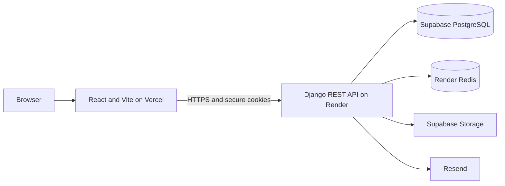

<p align="center">
  
</p>

<h1 align="center">Fotabo Hashi</h1>

<p align="center"><strong>Together we save lives.</strong><br />A bilingual blood donation and community support platform.</p>

<p align="center">
  <a href="https://github.com/ShoaibSikder/Fotabo-Hashi/actions/workflows/ci.yml"></a>
  
  
  
  
  <a href="LICENSE"></a>
</p>

Fotabo Hashi connects people who need blood with registered donors. Members can search donors, manage blood requests, and follow verified donation activity. Administrators use a separate workspace to manage accounts, requests, notices, active members, and platform activity.

The project is a React single-page application backed by a Django REST API. PostgreSQL stores application data, Redis supports production caching and throttling, Supabase Storage stores active-member photos, and Resend delivers account emails.

## Contents

- [Screenshots](#screenshots)
- [Features](#features)
- [Roles and routes](#roles-and-routes)
- [Technology](#technology)
- [Architecture](#architecture)
- [Repository structure](#repository-structure)
- [API overview](#api-overview)
- [Configuration notes](#configuration-notes)
- [Local development](#local-development)
- [Checks](#checks)
- [Deployment](#deployment)
- [License](#license)

## Screenshots

Screenshots are stored in [`frontend/public/system images`](frontend/public/system%20images).

### Public site and authentication

<p align="center">
  
</p>

<p align="center">
  
  
</p>

### Member and administrator workspaces

<p align="center">
  
  
</p>

<p align="center">
  
  
</p>

## Features

### Public site

- Responsive pages in English and Bangla.
- Organization information, notices, and active-member listings.
- Hero media served from frontend static assets.
- Direct entry points to donor search, blood requests, registration, and login.

### Member workspace

- Email and password registration, login, logout, and password reset.
- Secure HttpOnly access and refresh cookies with CSRF protection.
- Profile and donation-availability settings.
- Donor search by blood group, location, and search term.
- Create and manage blood requests, with ownership and status-transition rules.
- Leaderboard based on administrator-approved donation counts.
- In-app notifications and account settings.

### Administrator workspace

- Separate role-protected dashboard and navigation.
- Search and filter accounts by name, email, phone, and blood group.
- Create, review, update, and delete accounts, with safeguards for the current and last active administrator.
- Record verified donations and review member-submitted donation-count changes.
- Manage blood requests, notices, and active-member records.
- Review audit activity and administrator notifications.

### Platform protections

- Backend authorization is enforced by Django permissions; frontend route guards are an additional UI boundary.
- API pagination, throttling, request IDs, standardized errors, and liveness/readiness endpoints.
- PostgreSQL row-level security policies for protected records.
- Redis-backed production caching and rate limiting, with an in-memory local-development cache option.
- Automated Python and npm dependency audits, backend tests, frontend lint/build checks, and OpenAPI validation.

## Roles and routes

The application has two roles: `USER` and `ADMIN`. Public pages do not require an account.

| Access | Main routes |
| --- | --- |
| Public visitor | `/`, `/login`, `/register`, `/forgot-password`, `/reset-password` |
| `USER` | `/dashboard`, `/donors`, `/requests`, `/leaderboard`, `/profile`, `/settings` |
| `ADMIN` | `/admin/dashboard`, `/admin/users`, `/admin/donation-reviews`, `/admin/requests`, `/admin/public-content`, `/admin/audit` |

The API checks permissions independently. A hidden or inaccessible frontend route does not replace backend authorization.

## Technology

| Layer | Technologies |
| --- | --- |
| Frontend | React 18, Vite 6, React Router 7, Tailwind CSS 3, Lucide React |
| Backend | Python 3.13, Django 5.2, Django REST Framework |
| Authentication | Simple JWT, HttpOnly cookies, CSRF protection |
| Database | PostgreSQL; Supabase PostgreSQL for the hosted setup |
| Cache and rate limits | Redis, django-redis |
| Media | Supabase Storage |
| Email | Resend |
| Hosting | Vercel frontend, Render API |
| Quality | pytest, Ruff, Black, pip-audit, ESLint, npm audit |

## Architecture



The API is versioned under `/api/v1/`. Django settings are split into `base.py`, `development.py`, `testing.py`, and `production.py`. The Render blueprint runs database migrations before a deployment starts.

## Repository structure

```text
Fotabo-Hashi/
|-- .github/
|   |-- dependabot.yml
|   `-- workflows/ci.yml
|-- backend/
|   |-- api/v1/                 API routes and health endpoints
|   |-- apps/
|   |   |-- accounts/           Email-based user identity and authentication
|   |   |-- administration/     Admin APIs and management actions
|   |   |-- audit/              Security and admin activity records
|   |   |-- blood_requests/     Request lifecycle and ownership rules
|   |   |-- common/             Shared responses, pagination, and errors
|   |   |-- content/            Organization details, notices, and members
|   |   |-- donors/             Donor search
|   |   |-- leaderboard/        Verified donation counts and reviews
|   |   |-- notifications/      In-app notifications
|   |   `-- profiles/           Member profile data
|   |-- config/settings/        Environment-specific settings
|   |-- infrastructure/         Database, RLS, cache, storage, and monitoring
|   |-- tests/                  API, integration, performance, and security tests
|   |-- manage.py
|   |-- requirements.txt
|   `-- requirements-dev.txt
|-- frontend/
|   |-- public/                 Logo, screenshots, and static hero video
|   `-- src/
|       |-- app/                Providers and route configuration
|       |-- components/         Shared UI and layouts
|       |-- contexts/           Authentication and language state
|       |-- features/           Public, auth, member, and admin pages
|       |-- i18n/               English and Bangla translations
|       `-- services/           API client and endpoint helpers
|-- render.yaml
|-- LICENSE
`-- README.md
```

## API overview

Base URL: `https://<api-host>/api/v1/` (locally: `http://127.0.0.1:8000/api/v1/`).

| Endpoint | Description |
| --- | --- |
| `/health/`, `/health/live/`, `/health/ready/` | Basic, liveness, and dependency checks |
| `/auth/register/`, `/auth/login/`, `/auth/refresh/`, `/auth/logout/` | Account access and session endpoints |
| `/auth/password-reset/`, `/auth/password-reset/confirm/` | Password reset flow |
| `/profile/me/` | Current member profile |
| `/donors/` | Donor search and filtering |
| `/blood-requests/` | Request listing, creation, and status actions |
| `/blood-requests/mine/summary/` | Current member's request summary |
| `/leaderboard/` | Verified donation leaderboard |
| `/content/organization/`, `/content/notices/`, `/content/active-members/` | Public content |
| `/notifications/` | Member notifications and read state |
| `/admin/` | Protected account, donation, request, content, overview, and audit APIs |
| `/schema/`, `/docs/`, `/redoc/` | OpenAPI schema and interactive documentation |

## Configuration notes

- Backend local configuration template: [`backend/.env.example`](backend/.env.example).
- Frontend local configuration template: [`frontend/.env.example`](frontend/.env.example).
- Development requires a PostgreSQL `DATABASE_URL`; this project is configured for Supabase PostgreSQL rather than a local SQLite fallback.
- Redis is optional during local development. Enable it with `DJANGO_USE_REDIS_CACHE=True` only when a Redis server is running.
- Production uses Supabase Storage for active-member photos. Member profile image uploads are not supported; avatars are generated by the UI.
- The hero video is a static frontend asset, not a database-managed upload.
- Production-only credentials and configuration belong in Render/Vercel environment settings, never in committed files.
- Keep `DJANGO_SECRET_KEY`, database credentials, `SUPABASE_SERVICE_ROLE_KEY`, and `RESEND_API_KEY` server-side. Vite `VITE_*` variables are public in the built site.

## Local development

### Requirements

- Python 3.13
- Node.js 20 or later (CI uses Node.js 22)
- A PostgreSQL database and connection URL

### Backend (Windows PowerShell)

```powershell
cd backend
python -m venv .venv
.\.venv\Scripts\Activate.ps1
python -m pip install -r requirements-dev.txt
Copy-Item .env.example .env
```

Edit `backend/.env` and set `DATABASE_URL` to your PostgreSQL connection string. Then start Django:

```powershell
python manage.py check
python manage.py migrate
python manage.py createsuperuser
python manage.py runserver
```

The API is available at `http://127.0.0.1:8000/`.

### Frontend

In a second terminal:

```powershell
cd frontend
npm ci
Copy-Item .env.example .env
npm run dev
```

The Vite development site is available at `http://127.0.0.1:5173/`. Set `VITE_API_BASE_URL` to the local API root. If Vite uses another port, add that origin to the backend's `CORS_ALLOWED_ORIGINS` and `CSRF_TRUSTED_ORIGINS`.

## Checks

Run backend checks from `backend/`:

```powershell
ruff check .
black --check .
python manage.py check
pytest
python manage.py spectacular --validate --fail-on-warn
pip-audit -r requirements.txt
```

Run frontend checks from `frontend/`:

```powershell
npm ci
npm audit --audit-level=moderate
npm run lint
npm run build
```

GitHub Actions runs the backend checks with PostgreSQL and Redis services and runs the frontend audit, lint, and production build. The branch-protection checks are `test` and `frontend`.

## Deployment

### Render API

1. Create a Render Blueprint from [`render.yaml`](render.yaml).
2. Set the required production environment variables in Render. The backend requires a PostgreSQL `DATABASE_URL`, domain and CORS/CSRF configuration, Supabase Storage credentials, and a Resend API key and sender.
3. Point `FRONTEND_BASE_URL` to the deployed frontend. Add the frontend HTTPS origin to both `CORS_ALLOWED_ORIGINS` and `CSRF_TRUSTED_ORIGINS`; set `DJANGO_ALLOWED_HOSTS` to the API hostname.
4. Render builds the backend, runs migrations in the pre-deploy step, and starts Gunicorn. The blueprint provides a private Redis service.

### Vercel frontend

1. Import the repository and set the Vercel project root to `frontend`.
2. Set `VITE_API_BASE_URL` to `https://<api-host>/api/v1`.
3. Deploy and verify the public pages, login/logout, password reset, donor search, blood requests, and administrator access.

Use HTTPS custom domains for both services. Frontend and API subdomains under the same parent domain work well with secure cross-origin cookies. Keep the database and Render service in nearby regions to reduce round-trip latency. After deployment, check `https://<api-host>/api/v1/health/ready/` and create the initial administrator from the Render Shell:

```bash
python manage.py createsuperuser
```

The production settings require `STORAGE_BACKEND=supabase`, valid Supabase credentials, and a verified Resend sender. HSTS subdomain and preload options should only be enabled after all affected subdomains are HTTPS-only.

## License

Fotabo Hashi is licensed under the [MIT License](LICENSE).

---

Built by [@shoaibsikder](https://shoaibsikderportfolio.vercel.app) to help connect blood donors with the people and communities who need them.
